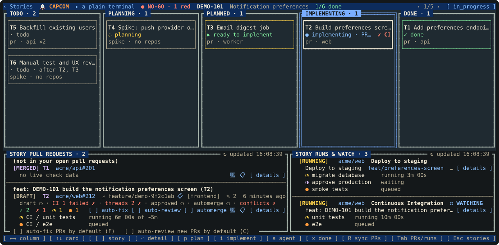
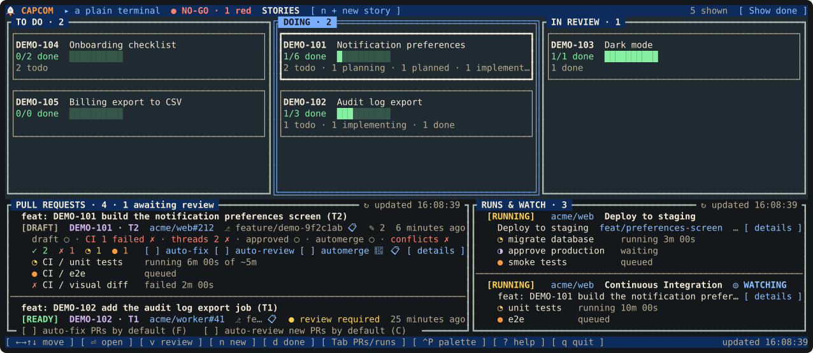
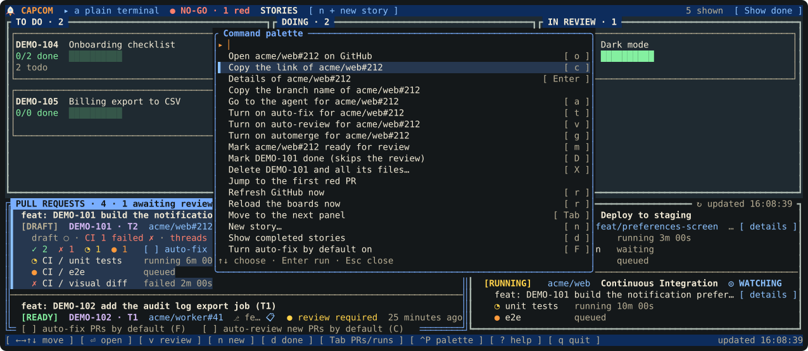
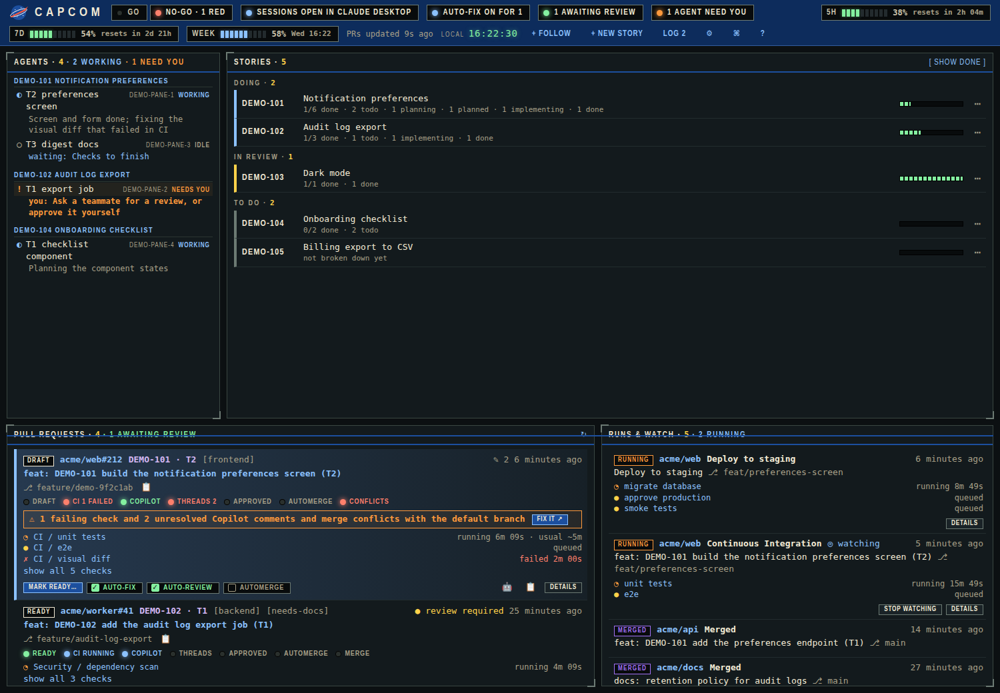
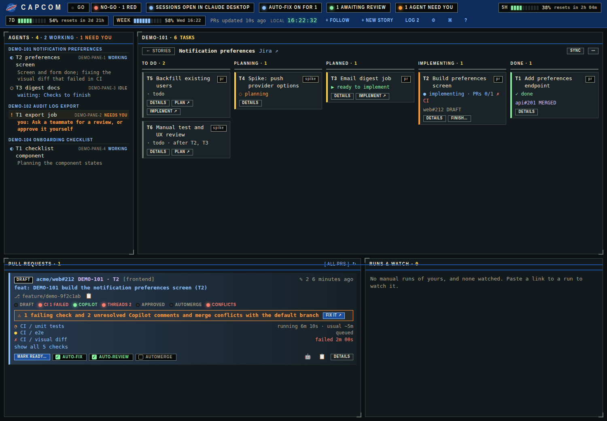
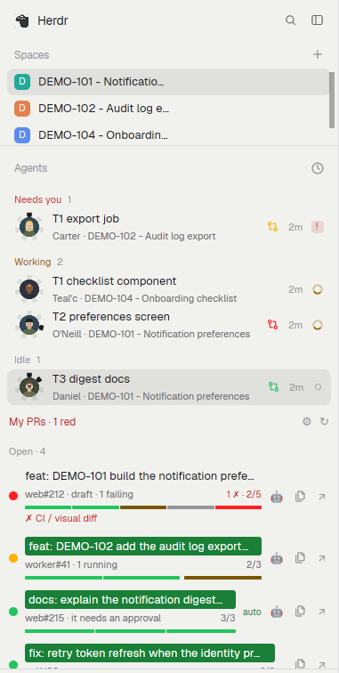

# CAPCOM

**Mission Control for story-driven work: one voice at the console.** Break a Jira story into PR-sized tasks, plan and implement each one with [Claude Code](https://claude.com/claude-code) skills, and watch all of it (tasks, draft PRs, CI stages, manual deploys) on one live board in your terminal.

[](https://github.com/philals/mission-control-capcom/actions/workflows/ci.yml)
[](LICENSE)

<p align="center">
  
</p>

> Every picture in this README is drawn from invented demo data (`acme/web`, `DEMO-101`). Try it yourself with no setup: `capcom-tui --demo` or `capcom web --demo`.

## Features

**Plan the work**
- Break a Jira story into PR-sized tasks with dependencies, agreed with you, and kept as plain local files (`board.json`, `story.md`, one markdown file per task).
- Task statuses `todo → planning → planned → implementing → done` (plus `dropped` and a `blocked` flag), with rules that refuse illegal moves.
- A task can need several PRs, in several repos; it only finishes when every one is merged.
- Stories move `in_progress → in_review → done`, reviewed against their acceptance criteria by `/story-review`.

**Do the work with Claude Code**
- Skills to break down, plan, implement and review, and to fix any PR (`/pr-address`). PRs are always drafts and never stacked.
- Start a skill from the board with a click, a drag or a pasted Jira key, in the app you already use.
- `/agent-note` gives every agent a one-line "what I'm doing, what I'm waiting on, what you need to do".

**Watch it all**
- Your open PRs with the rail `ready · CI · copilot · threads · approved · automerge · merge`, each CI stage live, and a lit-up block when a PR is green and waiting only for a reviewer.
- Your manual workflow runs (a nonprod deploy, say) and any run you paste a link to, with a desktop notification when one finishes.
- Your PRs merged in the last 12 hours, and the Claude plan usage gauges.
- A GO / NO-GO light for the lot.

**Let it do the boring part**
- `auto-review` asks Copilot to review a PR; `auto-fix` hands failing CI and review comments back to the agent that made the PR, up to 5 rounds.
- Mark a PR ready, toggle your merge bot's automerge label, or finish a task, each only when you click and confirm. capcom never merges anything.

**Get back to the agent**
- Every PR has a `🤖` button that focuses the session that made it, or resumes it if its tab was closed.

## Integrations

| Integration | What capcom does with it |
|---|---|
| **[Claude Code](https://claude.com/claude-code)** | Six skills; a console mod beside every session (`/capcom`); reads sessions to link PRs to the agent that made them |
| **Jira** (Atlassian MCP server) | The skills read the story, and create sub-tasks only if you ask |
| **GitHub** (`gh`) | PRs, CI checks, Copilot reviews, review threads, Actions runs, draft/ready, labels, branch updates |
| **Merge bot** (Kodiak style) | Reads its config for automerge and autoupdate labels; adds or removes them when you tick it |
| **[Herdr](https://herdr.dev)** terminal | A plugin that opens the board as an overlay and starts agents in panes |
| **Herdr desktop app** | The My Watch and SG-1 agents sidebar panels, and agents started in its panes |
| **Orca** | Starts and reaches agents in Orca terminals, and works from Orca's browser |
| **Claude Desktop** | Starts sessions with a skill typed in, and reaches them again |
| **Desktop notifications** | `notify-send`, when a run finishes, Copilot reviews or a PR needs you |
| **Browser** | `capcom web`, the whole TUI as a page on `127.0.0.1:1969` |

## Screenshots

### The terminal board: `capcom-tui`

<p align="center">
  
</p>

The command palette (`Ctrl+P`) lists every action that fits where you are, each with its key:

<p align="center">
  
</p>

### In a browser: `capcom web`

<p align="center">
  
</p>

<p align="center">
  
</p>

### In the Herdr desktop app: My Watch and SG-1 agents

<p align="center">
  
</p>

Each agent gets a Stargate SG-1 character whose ring of seven chevrons lights one step per stage of its PR; below, **My Watch** (+ adds a PR or Actions run link from the clipboard) shows each PR's CI as a strip of segments, with buttons for its agent, its link and its details. See [herdr-mod/README.md](herdr-mod/README.md).

## The name

**CAPCOM** (short for Capsule Communicator) is the designated communication liaison at NASA's Mission Control Center in Houston, Texas, who serves as the single voice speaking directly to astronauts in space.

This app is meant to be that voice for your work: one place that tells you what is planned, what is in flight and what needs you. The app and its commands are called `capcom` and `capcom-tui`; the repository is `mission-control-capcom` so it is easy to tell apart from the video-game company Capcom, which this project has nothing to do with.

## Read this first: it is one person's workflow

CAPCOM is built around **how its author works**, not around a general idea of project management. The author takes a Jira story, splits it into tasks that each become one or more *draft* pull requests (often in several repositories), reviews and merges them by hand, and likes to keep the real state in plain local files rather than in a tool. The statuses, the "no stacked PRs" rule, the draft-only PRs, the 1960s space-programme look and the Herdr integration all come from that mental model.

If that sounds like you, great. If not, treat this as a worked example: fork it, delete what you do not need, change the statuses and skills to fit how you work. Issues and ideas are welcome, but changes that pull it away from this model may be politely declined. See [CONTRIBUTING.md](CONTRIBUTING.md).

## What is in the box

| Part | What it does |
|---|---|
| **`capcom`** (command) | The only writer of each story's `board.json`: tasks, statuses, dependencies, PRs. Refuses illegal moves. Everything it prints is JSON. |
| **Six Claude Code skills** | `/story-break-down`, `/story-plan-task`, `/story-implement-task`, `/story-review`, `/pr-address` (works on any PR) and `/agent-note` (an agent's TLDR of what it is doing and waiting for, shown in the agents panel). They talk to you, Jira and `git`/`gh`, and change the board only through `capcom`. |
| **`capcom-tui`** | A live terminal board (keyboard and mouse): your stories, your open PRs with their CI stages, and the GitHub Actions runs you started by hand. It can start the skills for you and finish tasks when their PRs merge. |
| **Herdr app mods** (optional) | `capcom-prs` (My Watch) and `capcom-agents` (SG-1 agents) panels for the Herdr desktop app; install with `scripts/install-herdr-mod.sh`. |
| **Herdr plugin** (optional) | Opens `capcom-tui` from a keyboard shortcut in [Herdr](https://herdr.dev), and lets the board launch agents in Herdr panes. |

## How it works

```
 story ──► break down ──► board.json (tasks, deps) ──► plan task ──► implement task ──► draft PRs
 (Jira)   /story-break-down                            /story-plan-task  /story-implement-task
```

- **Local files are the source of truth.** Each story is a folder with a `board.json`, a `story.md` and one markdown file per task. Jira is only read, unless you ask for subtasks, which are created once.
- **Task statuses:** `todo → planning → planned → implementing → done`, plus `dropped`, and a `blocked` flag. A task can skip planning (`todo → implementing`) for spikes and manual testing. `done` means every expected PR is merged.
- **Story statuses:** `in_progress → in_review → done`, moved by `/story-review` once every task is finished.
- **PRs are always drafts, and never stacked.** You mark them ready and merge them yourself; capcom never merges anything (it can add or remove your merge bot's automerge label, but only when you tick it and confirm).
- **A task can need several PRs.** List a repo once per expected PR (`--repos api,api,ui` means two PRs in `api` and one in `ui`); the task cannot finish until all of them exist and are merged.

Design notes: [docs/design.md](docs/design.md). Command reference: [docs/reference.md](docs/reference.md).

## Quick start

### 1. Look around (no setup)

```bash
git clone https://github.com/philals/mission-control-capcom && cd mission-control-capcom
cargo install --path . --locked      # installs `capcom` and `capcom-tui` into ~/.cargo/bin
capcom-tui --demo                    # invented stories, PRs and runs; nothing is read or written
```

### 2. Use it for real

You need: [Rust](https://rustup.rs) 1.89 or newer, the [GitHub CLI](https://cli.github.com) (`gh auth login`), and [Claude Code](https://claude.com/claude-code) with the Atlassian MCP server if you want the skills to read Jira.

```bash
# a folder for your story data (keep it in its own repo if you like; capcom never needs it inside this one)
mkdir -p ~/stories
export CAPCOM_ROOT=~/stories         # also add this to your shell profile and to `env` in ~/.claude/settings.json

# make the skills visible to Claude Code
for s in story-break-down story-plan-task story-implement-task story-review pr-address agent-note; do
  ln -s "$PWD/skills/$s" ~/.claude/skills/$s
done
```

Then, in Claude Code:

| Step | Command | What it does |
|---|---|---|
| 1 | `/story-break-down PROJ-123` | Reads the story, proposes tasks and dependencies, agrees them with you, writes `$CAPCOM_ROOT/PROJ-123/`. Creates Jira subtasks only if you ask. |
| 2 | `/story-plan-task PROJ-123 T1` | Researches one task, asks you questions, writes the plan into the task file. Never changes code. |
| 3 | `/story-implement-task PROJ-123 T1` | Asks main checkout or worktree, implements the plan, opens **draft** PRs titled like `feat: PROJ-124 add notice endpoint (T1)`. |
| 4 | `/story-review PROJ-123` | When every task is done: checks the subtasks, reviews the story's acceptance criteria and intent against what was built, and tells you what it found. |

And in another terminal, `capcom-tui` shows it all and updates as the files change.

A typical run, in order: break the story down and approve the table; plan each task in dependency order; implement it; review and mark the draft PRs ready on GitHub yourself; when they merge, drag the card to DONE in the TUI (or run `capcom refresh PROJ-123`); repeat; finish with `/story-review`. More detail on resuming tasks and cleaning up worktrees is in the skills themselves (`skills/*/SKILL.md`).

## The terminal board

- **Stories and boards:** a kanban of your stories (TO DO, DOING, IN REVIEW) and a kanban per story with a card for each task (ready to implement, waits on dependencies, blocked, PRs merged). Drag a finished story from DOING to IN REVIEW and it opens a Herdr tab running `/story-review`.
- **Your PRs, with CI:** every open PR from a GitHub search you control, `[DRAFT]` or `[READY]`, with the CI stages that are running, queued or failed listed one per line. A PR that is all green and only waiting for a reviewer is lit up with a green `GO · ◉ AWAITING REVIEW` block, a green bar and a tinted row, and counted in the panel title. Click to open, copy the link, or mark a draft ready (it asks first). Paste someone else's PR link to follow it the same way (auto-fix starts off for it).
- **Back to the agent:** a PR made through a task has a `🤖` button that focuses the Claude Code session that made it in the app it runs in (Herdr, Orca or Claude Desktop), or resumes it (`claude --resume`) if the tab was closed. PRs you made outside the workflow work too: Claude Code records which session made each PR, and capcom reads that.
- **Copilot and fixing:** each PR shows Copilot's state (`reviewing`, `✎ 3 to fix`, `✔ reviewed`) and notifies you when its review lands. Two ticks on each of your PRs, `auto-review` and `auto-fix` (both on for new PRs unless you untick the defaults), do the loop for you: Copilot is asked to review the PR, and whenever CI fails or Copilot leaves comments the agent that made the PR is asked to merge the default branch in, fix the failures and address then resolve the comments (the `/pr-address` skill), up to 5 rounds and only when something has changed. A PR labelled `icebox` is never fixed or updated automatically. Boxes on the panel set the defaults.
- **Runs and watch:** the "Run workflow" runs you started, such as a nonprod deploy, plus any GitHub Actions run you paste a link to, and your PRs merged in the last 12 hours (in purple). Each shows its stages and a link, finished runs leave after 30 minutes, and you get a bell, a status line and (with `notify-send`) a desktop notification when one finishes.
- **Finishing tasks:** drag an IMPLEMENTING card to DONE (or press `x`) and capcom checks its PRs on GitHub, and only finishes the task if every one is merged.
- **Resizable and remembered:** drag any divider; sizes are saved.
- **Accessible by design:** a fixed theme with at least 4.5:1 text contrast on every screen (a test checks it), state shown with words and icons as well as colour, and focus shown by a double border.

Try the page with `capcom web --demo`. Everything it does, every key and every setting is in [docs/tui.md](docs/tui.md). Everything the TUI does is also a page in a browser, for people who live in Claude Code (terminal and desktop app) rather than Herdr: `capcom web` ([docs/web.md](docs/web.md)) shows the boards, your PRs with their CI, your workflow runs and your running Claude Code sessions, can mark PRs ready, toggle automerge, finish tasks and sync stories after asking, and opens a Claude Code desktop session with a skill typed in to plan, implement, review or fix.

## The console in every session

`mod/` is a Claude Code mod that puts a small CAPCOM console in a pane beside any session, opened with `/capcom` (the desktop app, the terminal, VS Code): GO / NO-GO, the plan usage gauges, the PRs that need you and the agents waiting on you. Click a PR to open it, `fix it ↗` to copy the fixing prompt and open the PR's session to paste it into, or an agent to go to its session. It reads `capcom web` (it must be running, on port 1969) and takes the page's actions through it. Install it once, at the prompt of a terminal session:

```
/plugin install capcom --marketplace philals/mission-control-capcom
```

or from a shell, `claude plugin install capcom --marketplace philals/mission-control-capcom`. In the desktop app: + next to the prompt box, Plugins, Add marketplace `philals/mission-control-capcom`, then Add plugin. It stays closed until you type `/capcom`, which opens it beside the chat. See [docs/web.md](docs/web.md#the-console-in-every-session).

## Configuration

| Setting | Flag | What it is | Default |
|---|---|---|---|
| `CAPCOM_ROOT` | `--root` | Folder holding one folder per story | required (not with `--demo`) |
| `CAPCOM_PR_QUERY` | `--pr-query` | GitHub search for the PR panel (`@me` is resolved by GitHub) | `is:pr author:@me state:open archived:false sort:updated-desc -label:icebox` |
| `CAPCOM_DEPLOY_REPOS` | `--deploy-repos` | Extra `owner/name` repos (comma separated) to look for your manual runs in | repos of your PRs and stories |
| `CAPCOM_WORKDIR` | `--workdir` | Where new sessions start when a task has no folder | the current folder, or `~/code` when that is `~` |
| `CAPCOM_HOST` | `--host` | The app new sessions open in: `herdr`, `herdr-app`, `orca` or `desktop` (anything else is refused) | the app the terminal belongs to |
| `CAPCOM_TUI_SETTINGS` | | File for the saved panel sizes | `~/.config/capcom/tui.json` |
| `CAPCOM_CACHE_DIR` | | Shared GitHub cache | `~/.cache/capcom` |
| | `--no-prs`, `--no-runs` | Turn the PR or runs panel off | |

## Herdr, the Herdr app, Orca and Claude Desktop

New sessions open in the app you are using when you start them: `capcom-tui` in a Herdr pane opens them in Herdr, in a pane of the Herdr desktop app in that app, in an Orca terminal in Orca, and in Claude Desktop's terminal panel in Claude Desktop; the web page opens them in Claude Desktop, or in Orca when opened in Orca's browser as `http://127.0.0.1:1969/?host=orca`. Clicking an agent takes you to it in whichever app it runs in. See [docs/tui.md](docs/tui.md#starting-agents-herdr-the-herdr-app-orca-or-claude-desktop).

If you use [Herdr](https://herdr.dev), `capcom-tui` run inside a Herdr pane can start the skills for you: paste a Jira key to start a breakdown, or drag a card onto PLANNING or IMPLEMENTING. The repo is also a Herdr plugin with an `open` action, so a key such as `prefix+y` opens the board as an overlay. Install it with `herdr plugin install philals/mission-control-capcom` (it builds the binaries, so it needs Rust; read [Herdr's trust note](https://herdr.dev/docs/plugins/#trust-and-security) first, since a plugin is ordinary code), then bind a key as described in [docs/tui.md](docs/tui.md#herdr-plugin). Nothing here needs Herdr; outside it those features are simply off.

## Privacy and security

- **No project data in this repo.** Your stories live in the folder you choose. The examples and tests use invented names (`acme/widgets`, `PROJ-123`, `DEMO-101`).
- **One credential, in memory only.** capcom asks your `gh` for its token (`gh auth token`) once when it starts, keeps it in memory, and sends it only to `api.github.com` over HTTPS. It never writes it to disk or logs it. Calling the API directly instead of starting `gh` for every request is what keeps the board light on CPU (about 2 ms a call instead of about 150 ms). If you would rather capcom never held the token, set `CAPCOM_NO_NATIVE_HTTP=1`: every GitHub call then goes through the `gh` command, as before. Marking a PR ready and asking Copilot for a review always use `gh`.
- **What it changes on GitHub** is only what you click or tick: a PR's draft or ready state, a Copilot review request, its automerge label, and with auto-fix ticked, bringing a branch up to date or asking an agent to fix it.
- **No telemetry.** The only calls are to GitHub and, when you ask the skills to, your Atlassian MCP server to Jira.
- **What is written to disk:** the boards (only by `capcom`, under a lock), your panel sizes, and a small cache of GitHub results that is readable only by you and tidied after a day.
- **Found a vulnerability?** See [SECURITY.md](SECURITY.md).

## Development

```bash
cargo build
cargo test                                   # the whole suite (it is quick)
cargo test --bin capcom-tui <name>           # one test
capcom-tui --demo                            # a quick look at UI changes
capcom web --demo                            # the web page over invented data (photograph it with headless Chrome)
capcom prs --demo                            # the Herdr panels' feed, invented (the Herdr pictures run this in an isolated Herdr app)
capcom-tui --screenshot docs/img/board.svg --screen board --size 150x34   # regenerate the README pictures
capcom-tui --screenshot docs/img/list.svg  --screen list  --size 150x30
capcom-tui --screenshot docs/img/palette.svg --screen palette --size 150x30
```

```
src/                      the capcom command and its library (board model, rules, store, refresh)
src/bin/capcom-tui/       the terminal board (app state, drawing, GitHub polling, Herdr, cache, demo data)
skills/                   the six Claude Code skills
schemas/board.schema.json JSON Schema for board.json
herdr-mod/                the Herdr app panels (My Watch, SG-1 agents)
src/demo.rs               the invented data behind every --demo and every picture
herdr-plugin.toml         the Herdr plugin manifest (scripts/open.sh is its action)
docs/                     design notes, command reference, TUI and web guides, README pictures
```

## Contributing

Please read [CONTRIBUTING.md](CONTRIBUTING.md) first, especially the note at the top of this page about whose workflow this is.

## Credits

The look of the original board owes a debt to [herdr-board](https://github.com/nelsonPires5/herdr-board), and the whole thing to Herdr and Claude Code. The 1960s space-programme theme is a nod to the people who actually did mission control.

## License

[MIT](LICENSE)
